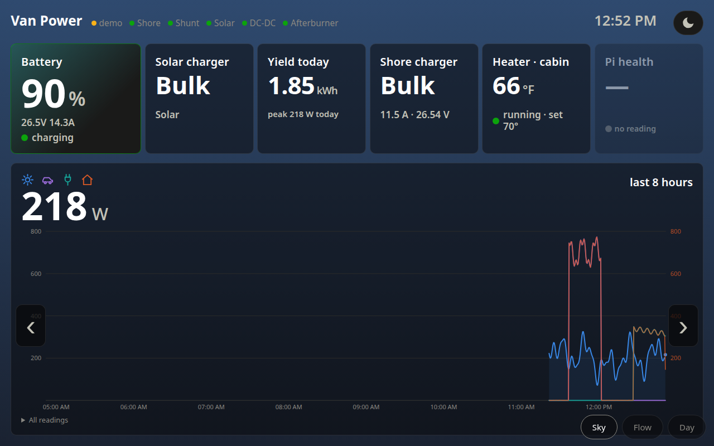

# van-dashboard

A power dashboard for a camper van, running on a Raspberry Pi with a 7 inch
touch panel. It listens passively to Victron's Bluetooth "instant readout"
advertisements (no pairing, no connections), reads a diesel heater controller
over WebSocket or BLE, polls a JBD battery BMS, and renders everything as a
full-screen dark kiosk. It also decides when the Starlink dish is allowed to
run, based on battery state of charge.



## What it does

- **Victron decode without pairing.** Victron devices broadcast an encrypted
  state in their BLE adverts. The collector decodes them with the per-device
  key from VictronConnect. Readings are matched by key and device kind, not
  Bluetooth address, so one config works on macOS (UUIDs) and Linux (MACs).
- **Garbage rejection.** The advert format is AES-CTR with a single key-check
  byte and no authentication, so a neighbour's device collides about 1 in 256
  times and decrypts to noise. A minimum RSSI and per-kind plausibility ranges
  (`PLAUSIBLE_RANGES` in `collector.py`) reject those; the first version of
  this code logged a phantom 443 W solar spike before the guards existed.
- **Starlink duty cycle.** A Shelly relay on the dish's DC feed is driven by
  state of charge with hysteresis: above `soc_restore` the dish stays on;
  below `soc_low` it is off except for a short sync window every period so the
  remote tunnel and the auto-updater still get online. Window "on" commands
  carry the relay's own `toggle_after` watchdog, so the dish turns itself off
  even if the dashboard dies. Unknown state of charge holds the current state.
  The kiosk has a "stay on 12 h" hold that survives restarts. Mode changes are
  refused over the public tunnel; only the LAN can change them.
- **Mirror and uplink.** The Pi pushes its state every 30 s to an always-on
  copy of the app running in mirror mode somewhere with reliable internet, and
  backfills history the mirror lacks after an outage. The mirror shows the same
  views with a "van seen N min ago" chip and no controls.
- **Self-updating kiosk.** A systemd timer checks the repository every five
  minutes, keeps the Pi's local config, data and venv, and restarts only when
  the revision changes. `setup.sh` provisions a fresh Pi OS Lite flash in one
  command: labwc Wayland kiosk, rotated panel, touch rebinding, services.

## Run

Requires [uv](https://docs.astral.sh/uv/).

```sh
cp config.example.toml config.toml   # fill in your device keys
uv run python -m vandash             # http://localhost:8080
VANDASH_DEMO=1 uv run python -m vandash   # synthetic data, no radios needed
uv run --with pytest pytest -q       # tests
uv run scan.py                       # 12 s BLE scan, flags Victron devices
uv run test_keys.py                  # check config keys decode live data
```

Views: `/v/sky` (tiles and an 8 hour chart, background follows daylight),
`/v/flow` (animated energy flow), `/v/day` (sun arc with yesterday's ghost).

## Layout

```
vandash/collector.py      BLE scan -> victron-ble decode -> PowerState
vandash/afterburner.py    heater over WebSocket; afterburner_ble.py the BLE fallback
vandash/epoch.py          JBD BMS over GATT
vandash/starlink.py       relay policy (state machine, unit tested)
vandash/storage.py        SQLite history buckets
vandash/server.py         aiohttp: views, /api/state, /api/day, /api/starlink, /api/ingest
vandash/uplink.py         push to the mirror; tunnel.py runs cloudflared on the Pi
vandash/pihealth.py       throttling, temperature and under-voltage watch
vandash/static/           views and the shared chart core
deploy/                   systemd units, labwc kiosk config, touch rules, updater
setup.sh                  one-shot Pi provisioning
tests/                    starlink policy, storage, mirror ingest
```

## Hardware notes

- Raspberry Pi 5, 7 inch DSI panel (ili9881c), Goodix touch. The touch
  controller loses its boot probe before the panel powers, so a service rebinds
  it; a udev rule applies the 90 degree calibration matrix.
- Power the Pi from a proper 5 V / 5 A supply. A pinched DSI ribbon and a weak
  supply both produced under-voltage throttling during the build; `pihealth`
  exists because of that.
- The Starlink Mini runs straight off the 24 V bank and is the biggest parked
  load (about 30 W, 720 Wh a day). Set the Shelly's power-on default to ON so a
  brownout cannot strand the van offline.

## Not included

- `config.toml` with the real device keys, addresses and tokens. Copy the
  example and fill it in.
- Cloudflare tunnel credentials. `tunnel.py` expects them at
  `deploy/tunnel/credentials.json`, which is not in this repository.
- One of the four views, which was a purely decorative variant.
- Logged data from the van.

## Licence

MIT, see `LICENSE`. Copyright 2026 Eamon White.
